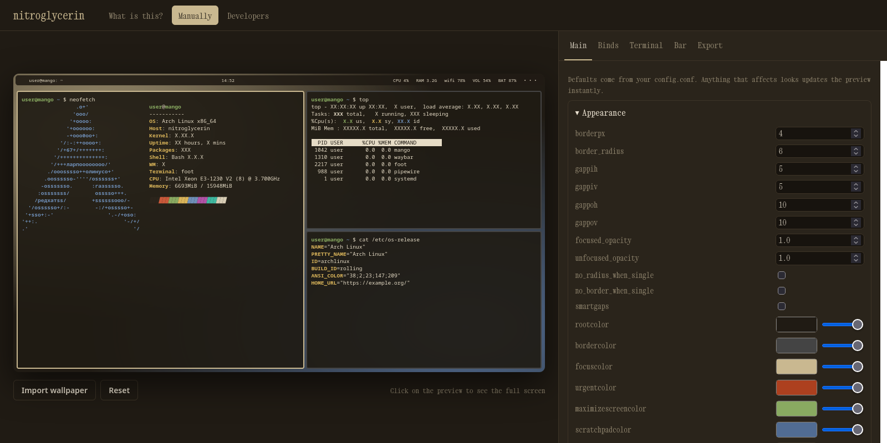

<div align="center">

# nitroglycerin

**A highly convenient config generator for [MangoWM](https://github.com/mangowm/mango).**

Tune your compositor, terminal, and status bar in one place.
See every change live, then export configs that are ready to use.

[](https://neadvokats.github.io/nitroglycerin/manually)
[](LICENSE)


</div>

[](https://neadvokats.github.io/nitroglycerin/manually)

<p align="center"><sub>A live desktop preview on the left, every supported MangoWM option on the right.</sub></p>

## Why nitroglycerin?

MangoWM is a fast, dwl-inspired Wayland compositor with a deeply configurable setup. The trade-off is the usual edit–reload–repeat loop: remember an option name, change one line in `config.conf`, reload, and squint at the result.

nitroglycerin turns that into a visual workflow. Every supported option has a proper control, the desktop preview reacts instantly, and the output is a clean config file — plus matching themes for your terminal and status bar.

It is a static, client-side app. No backend, no account, no build step. Open the page, make it yours, and export.

## Features

- **Visual MangoWM editor** — 100+ options across appearance, shadows, blur, dimming, animations, layouts, overview, behavior, keyboard, trackpad, and mouse. Booleans are switches, numbers are bounded inputs, and colors get a picker with a separate alpha slider.
- **Live desktop preview** — a 1600px virtual screen with three terminal windows showing `neofetch`, `top`, and `cat /etc/os-release`. Gaps, borders, radius, opacity, blur, shadows, colors, the bar, and the terminal theme all update as you type. Import a wallpaper for the preview or click it to go fullscreen.
- **Keybind manager** — edit `bind`, `mousebind`, and `axisbind` entries, search the list, autocomplete action names, and press **Record** to capture a key combination instead of typing it.
- **Terminal designer** — generate configs for Alacritty, foot, and kitty with a custom font, size, opacity, padding, and the full 8-color ANSI palette. Includes the Mango warm, Nord, and Mocha presets, plus custom ASCII logos for the preview.
- **Status bar builder** — generate a Waybar config and stylesheet, or an experimental Polybar config. Assign nine modules — workspaces, window title, clock, CPU, memory, network, volume, battery, and tray — to the left, center, right, or off. Waybar supports all nine; the Polybar output covers the modules listed in the app.
- **Import existing configs** — drop in a MangoWM, Alacritty, foot, or kitty config and the format is detected automatically. Unknown MangoWM lines are kept in the **Rules** section, so custom rules are not lost.
- **Per-file additions** — append your own snippets to any generated file. For Waybar, additions are merged as JSON entries and override generated keys with the same name.
- **Local-first and persistent** — everything is generated in your browser and saved to `localStorage`. No account, no upload, no telemetry.
- **Copy, download, done** — every export has the right filename and comment syntax, ready to drop into place.

## Quick start

### Use the hosted version

Open **[neadvokats.github.io/nitroglycerin/manually](https://neadvokats.github.io/nitroglycerin/manually)** and start customizing. Nothing to install.

### Run it locally

```bash
git clone https://github.com/neadvokats/nitroglycerin.git
cd nitroglycerin
python3 -m http.server 8000
```

Then open [http://localhost:8000/manually.html](http://localhost:8000/manually.html).

Any static file server works. There is no `npm install`, no bundler, and no compilation step. A modern browser with container query support is required.

## Generate your config

1. Open the **Manually** page.
2. Tune the compositor in **Main**, then set up shortcuts in **Binds**, your terminal in **Terminal**, and the bar in **Bar**. The preview updates immediately.
3. Open **Export**, choose the file you need, and use **Copy** or **Download**.
4. Review the result and put it in place:

| Target | Export filename | Destination |
| --- | --- | --- |
| MangoWM | `config.conf` | `~/.config/mango/config.conf` |
| Alacritty | `alacritty.toml` | `~/.config/alacritty/alacritty.toml` |
| foot | `foot.ini` | `~/.config/foot/foot.ini` |
| kitty | `kitty.conf` | `~/.config/kitty/kitty.conf` |
| Waybar config | `config.jsonc` | `~/.config/waybar/config.jsonc` |
| Waybar style | `style.css` | `~/.config/waybar/style.css` |
| Polybar (experimental) | `config.ini` | `~/.config/polybar/config.ini` |

MangoWM's default configuration lives at `/etc/mango/config.conf`; the user config is read from `~/.config/mango/config.conf`.

> [!TIP]
> Already have a config? Use **Export → Import config**. nitroglycerin detects MangoWM, Alacritty, foot, and kitty files automatically and fills in the editor. Waybar and Polybar configs are not imported.

## How it works

The project is intentionally small and dependency-free:

- `SCHEMA_TEXT` in `js/app.js` is the source of truth for MangoWM options. The editor, the live preview, and the generated config all read from it.
- A single `state` object holds the compositor options, keybinds, terminal theme, bar settings, and per-file additions. It is persisted in `localStorage` under the `nitroglycerin` key.
- Each export target has a small generator: `generateMango()`, `generateAlacritty()`, `generateFoot()`, `generateKitty()`, `generateWaybarConfig()`, `generateWaybarStyle()`, and `generatePolybar()`.
- The preview maps config values to CSS custom properties on a container-query-scaled stage, so it stays proportional at any window size.

## Project structure

```text
nitroglycerin/
├── index.html       # "What is this?" landing page
├── manually.html    # the generator
├── developer.html   # credits
├── css/
│   └── style.css
├── js/
│   └── app.js       # schema, state, preview, import/export
├── assets/
│   └── preview.png
├── LICENSE
└── README.md
```

## Extending the generator

### Adding a MangoWM option

Add one line to `SCHEMA_TEXT` in `js/app.js`, under the relevant `#Group`:

```text
borderpx|n|4|0|20|1
```

The format depends on the control type:

| Type | Control | Format | Example |
| --- | --- | --- | --- |
| `n` | Number | `key\|n\|default\|min\|max\|step` | `borderpx\|n\|4\|0\|20\|1` |
| `b` | Switch | `key\|b\|default` | `shadows\|b\|0` |
| `c` | Color + alpha | `key\|c\|0xRRGGBBAA` | `focuscolor\|c\|0xc9b890ff` |
| `o` | Dropdown | `key\|o\|default\|option1/option2` | `animation_type_open\|o\|slide\|slide/zoom` |
| `t` | Text | `key\|t\|default` | `animation_curve_open\|t\|0.46,1.0,0.29,1` |

The editor control and the generated config line appear automatically. If the option should also affect the preview, map it to a CSS variable in `renderPreview()`.

### Adding a new export target

1. Write a `generate<Name>()` function that returns the file contents as a string.
2. Register it in `TARGETS` with its label, filename, and generator.
3. Add its comment syntax to `COMMENT` so custom additions are formatted correctly.

## Troubleshooting

- **The Copy button does nothing.** The Clipboard API requires a secure context. Use the hosted HTTPS version or `localhost`; `file://` pages may be blocked by the browser.
- **My settings disappeared.** The app stores them in `localStorage`. Clearing site data, using private browsing, or switching browsers may start from the defaults.
- **My wallpaper reset after reload.** Wallpapers are only used for the preview and are not persisted; import it again after reloading.
- **Waybar does not show a module.** The generated config uses `dwl/tags` and `dwl/window` and assumes the other modules are installed. Adjust module names such as `pulseaudio` to match your Waybar build.
- **Polybar on Wayland.** Polybar is an X11 bar; on Wayland, use Waybar. The Polybar output is experimental.

## Roadmap

- [x] Visual MangoWM config generator
- [x] Keybind editor with key recording
- [x] Alacritty, foot, and kitty themes
- [x] Waybar and Polybar output
- [x] Import existing MangoWM and terminal configs
- [ ] Support for more Wayland compositors
- [ ] Portable profile export and import as a single file
- [ ] More bar modules, presets, and preview scenes

## Contributing

Issues and pull requests are welcome. Since there is no build step, the workflow is simple:

1. Fork and clone the repository.
2. Run the app locally with `python3 -m http.server 8000`.
3. Make your change and verify the preview plus every export target you touched.
4. Open a pull request with a short explanation of the change.

Please keep the project dependency-free, match the existing code style, and test in a modern browser.

## Credits

Created by [NeAdvokats](https://github.com/neadvokats), with help from [Claude](https://claude.ai). Built around [MangoWM](https://github.com/mangowm/mango) and its example configuration.

## License

[MIT](LICENSE) © 2026 NeAdvokats

---

<p align="center"><sub>If nitroglycerin saves you some config time, consider giving the repository a star.</sub></p>
